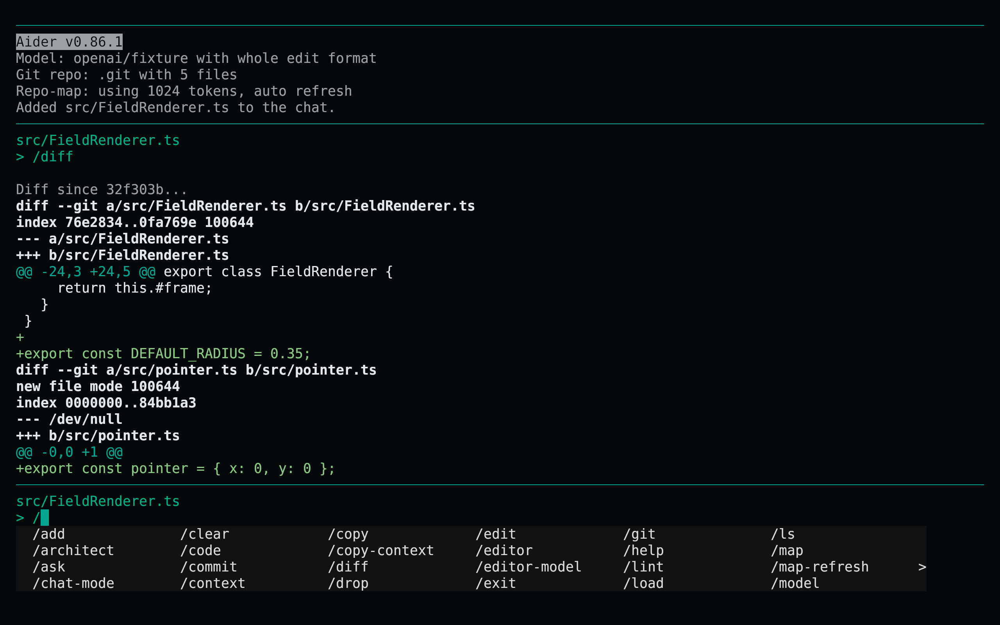
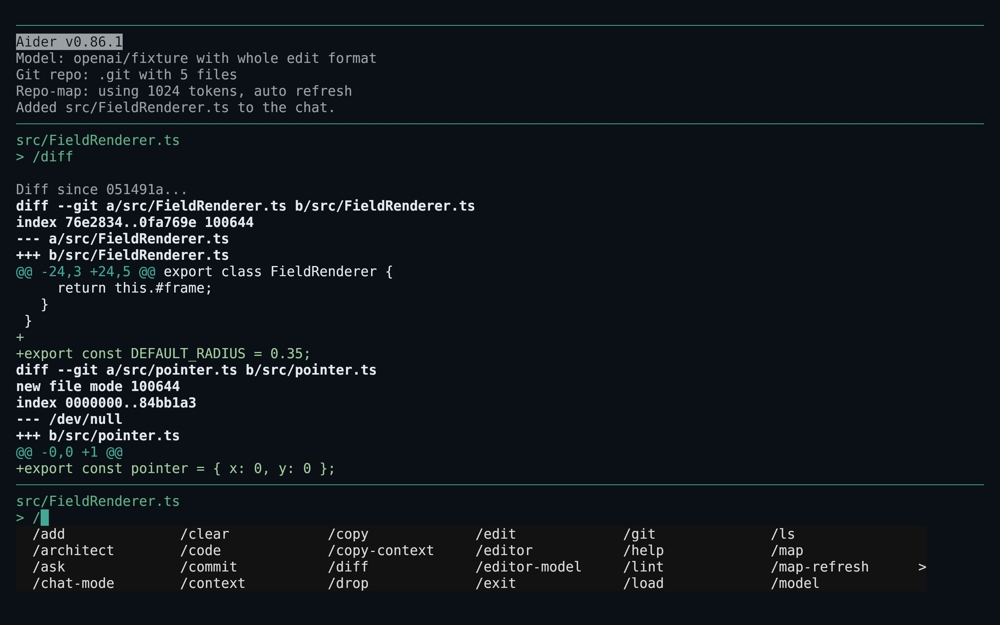
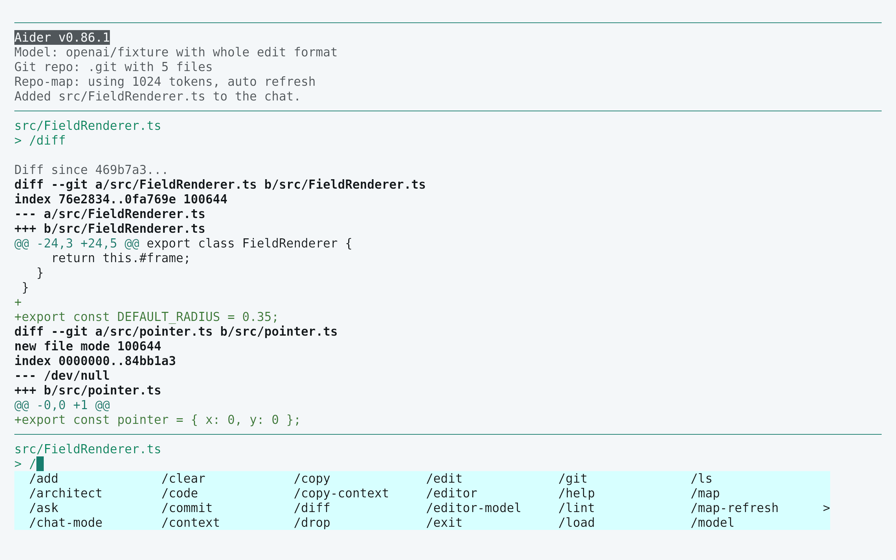
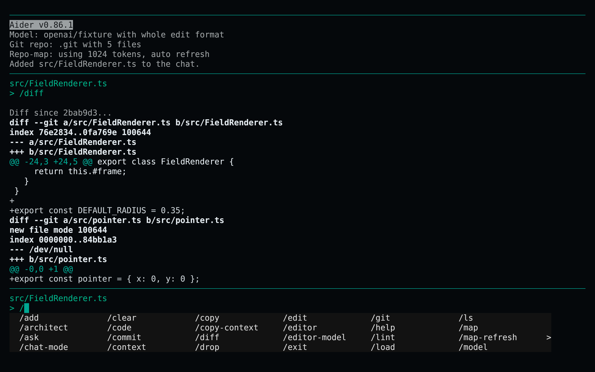

<!-- living-code-readme:1 -->
# 🛠️ Living Code for Aider

**Calm slate. Living color.** Living Code for Aider: native YAML colors for user and assistant messages, warnings, errors and completion-menu states.

[Installation](#installation) · [Flavors](#flavors) · [Configuration](#configuration) · [All ports](https://github.com/living-code-theme)

## Previews

<table data-lc-flavors>
<tr>
<td width="50%" valign="top">
<strong>Night</strong><br><sub>Dark · full palette</sub><br><br>
<a href="images/night.png"></a>
</td>
<td width="50%" valign="top">
<strong>Frost</strong><br><sub>Dark · softer chroma</sub><br><br>
<a href="images/frost.png"></a>
</td>
</tr>
<tr>
<td width="50%" valign="top">
<strong>Paper</strong><br><sub>Light · near-white slate</sub><br><br>
<a href="images/paper.png"></a>
</td>
<td width="50%" valign="top">
<strong>Signal</strong><br><sub>Dark · teal accent</sub><br><br>
<a href="images/signal.png"></a>
</td>
</tr>
</table>

Select any preview to view the image at full size.

## Installation

```sh
flavor=night # night, frost, paper, or signal
curl -fsSL --create-dirs -o "${XDG_CONFIG_HOME:-$HOME/.config}/aider/themes/living-code-$flavor.yml" "https://raw.githubusercontent.com/living-code-theme/aider/main/themes/living-code-$flavor.yml"
aider --config "${XDG_CONFIG_HOME:-$HOME/.config}/aider/themes/living-code-$flavor.yml"
```

This uses a separate color-only config instead of overwriting `~/.aider.conf.yml`. To keep all your existing Aider settings active together, merge the nine color options from the downloaded file into your user or project config. Preserve credentials, model and editing settings.

## Flavors

Expand a flavor for its full-size preview and activation instructions.

<details data-lc-flavor="night">
<summary><strong>Night</strong> · Dark · full palette</summary>

<p><a href="images/night.png"></a></p>

```sh
aider --config "${XDG_CONFIG_HOME:-$HOME/.config}/aider/themes/living-code-night.yml"
```

</details>

<details data-lc-flavor="frost">
<summary><strong>Frost</strong> · Dark · softer chroma</summary>

<p><a href="images/frost.png"></a></p>

```sh
aider --config "${XDG_CONFIG_HOME:-$HOME/.config}/aider/themes/living-code-frost.yml"
```

</details>

<details data-lc-flavor="paper">
<summary><strong>Paper</strong> · Light · near-white slate</summary>

<p><a href="images/paper.png"></a></p>

```sh
aider --config "${XDG_CONFIG_HOME:-$HOME/.config}/aider/themes/living-code-paper.yml"
```

</details>

<details data-lc-flavor="signal">
<summary><strong>Signal</strong> · Dark · teal accent</summary>

<p><a href="images/signal.png"></a></p>

```sh
aider --config "${XDG_CONFIG_HOME:-$HOME/.config}/aider/themes/living-code-signal.yml"
```

</details>

## Configuration

The files map exactly Aider’s nine documented `*-color` options. Do not combine them with `--dark-mode` or `--light-mode`, which replace these colors with Aider presets. This port intentionally leaves `code-theme` alone so it does not replace your syntax theme with an unrelated preset. Completion foreground/background and the selected entry are explicitly paired.

## Compatibility

For Aider versions exposing the nine color flags listed in `test/fixtures/upstream.json`. This is a UI-color port, not a custom Pygments style. Aider’s rendered code blocks continue to use your configured `code-theme`; the terminal owns the full-screen background. Use a matching Living Code terminal theme for the rest of the palette. Tests parse native YAML and verify accepted flag names and semantic colors.

Previews are captured programmatically from the actual application in an isolated profile. See [`capture/app.py`](capture/app.py) for the app-owned recipe and [`images/capture.json`](images/capture.json) for runtime, palette and image provenance. No mock interface is drawn.

## Contributing

Found a problem? [Open an issue](https://github.com/living-code-theme/aider/issues/new/choose) with the app version, the flavor and a screenshot. Want Living Code somewhere else? [Request a port](https://github.com/living-code-theme/core/issues/new?template=port-request.yml).

Pull requests are welcome. Keep this README, `port.json` and `images/` in sync, and use real screenshots of the app, never mockups.

🦎 **One chameleon, many habitats.** Part of [Living Code](https://github.com/living-code-theme).

## License

[MIT](LICENSE) © Elliot Luque
